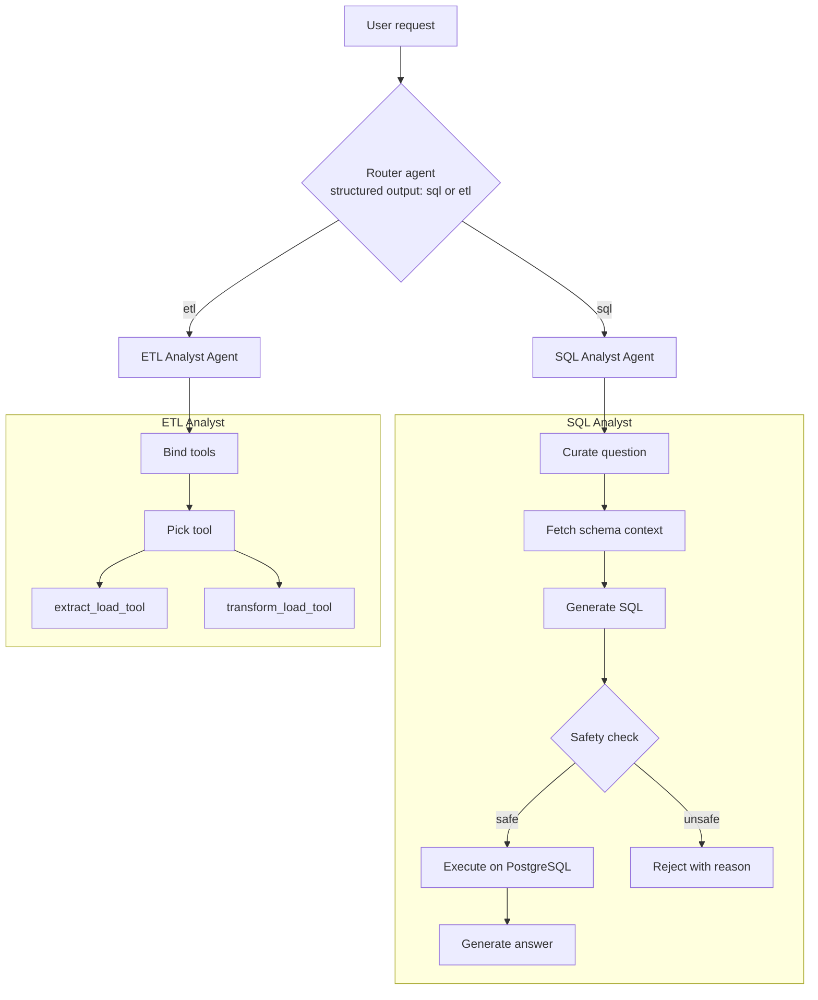

# Agentic Data Assistant

A multi-agent system built with **LangGraph** that turns plain-English requests into either **SQL analysis on PostgreSQL** or **ETL workflows** (API extraction and Pandas transformation). A router agent classifies each request and hands it to the right specialist agent.


<!-- TODO: record a short GIF of a SQL query and an ETL request running, save it as docs/demo.gif -->

**Stack:** Python 3.12 · LangGraph · LangChain · PostgreSQL · Pandas · Pydantic · Anthropic / OpenAI APIs · uv

---

## What it does

| You say | The system does |
|---|---|
| "Show me the top 5 users with the highest ratings" | Router → **SQL Analyst** → reads the schema, generates SQL, validates it, runs it, explains the result |
| "Extract data from `https://pokeapi.co/api/v2/pokemon` and save it as CSV" | Router → **ETL Analyst** → calls the API, normalizes the JSON, saves to `data/extract/` |
| "Keep only rides with rating > 4.5 and save as JSON" | Router → **ETL Analyst** → generates Pandas code, runs it, saves to `data/transform/` |

## Architecture



### Design decisions

- **Router with structured output.** The router returns a Pydantic `RouterSchema` (`sql` or `etl`, plus its reasoning), so routing is typed and easy to debug instead of relying on free text.
- **Dynamic LLM selection.** `utils/llm_pick.py` picks a model by task complexity, using a cheaper model for simple requests and a stronger one for complex requests, to control cost and latency.
- **Separate agent state per agent.** Each agent has its own Pydantic state schema (`Models/schema.py`), which keeps the graphs independent and easier to test.
- **Tool-based ETL.** The ETL agent works through explicit tools (`extract_load_tool`, `transform_load_tool`) rather than open-ended code execution.

## Features

**Router**
- Classifies intent as SQL or ETL
- Conditional routing in a LangGraph state graph

**SQL Analyst**
- Natural language to SQL
- Automatic schema discovery for prompt context
- Query refinement (question curation) before generation
- Safety validation before execution, which blocks `INSERT`, `UPDATE`, `DELETE`, `DROP`, `ALTER` and similar statements
- Default `LIMIT 10` unless the user asks for more

**ETL Analyst**
- Extracts from REST APIs and flattens JSON into tables
- Transforms data with generated Pandas code
- Writes CSV (default), JSON, or Parquet

## Getting started

### Prerequisites
- Python 3.12+
- PostgreSQL running locally (or reachable over the network)
- An Anthropic and/or OpenAI API key

### 1. Clone and install

```bash
git clone https://github.com/Tushar-me24/AI-Agent.git
cd AI-Agent

# with uv (recommended)
uv sync

# or with pip
python -m venv .venv
source .venv/bin/activate        # Windows: .\.venv\Scripts\Activate.ps1
pip install -r requirements.txt
```

### 2. Configure environment

Create a `.env` file in the project root:

```env
# LLM providers
ANTHROPIC_API_KEY=your_anthropic_key
OPENAI_API_KEY=your_openai_key

# PostgreSQL
host=localhost
port=5432
user=postgres
password=your_password
database=data_agent_db
```

Model names are chosen in `utils/llm_pick.py`. Check Anthropic's and OpenAI's docs for current model names and update them there as models change.

### 3. Load the sample data

```bash
python feed_db.py
```

This loads the CSVs in `data/` (`users`, `rides`, `vehicles`, `payments`, `ratings`) into PostgreSQL, a ride-sharing dataset to query against.

### 4. Run

```bash
python main.py
```

Or call the agent from Python:

```python
from agents.data_agent import data_agent
from langchain_core.messages import HumanMessage

result = data_agent.invoke({
    "messages": [HumanMessage(content="Show me the average rating for each vehicle type")],
    "route_response": "",
})
print(result)
```

## Project structure

```
AI-Agent/
├── agents/
│   ├── data_agent.py      # Router agent and top-level graph
│   ├── sql_analyst.py     # SQL agent (curate → context → generate → validate → execute → answer)
│   └── etl_analyst.py     # ETL agent (tool-calling: extract / transform)
├── Models/
│   └── schema.py          # Pydantic state schemas (Router, SQL, ETL, Data Agent)
├── utils/
│   ├── database.py        # PostgreSQL connection and schema introspection
│   ├── etl_tools.py       # extract_load_tool, transform_load_tool
│   └── llm_pick.py        # Model selection by task complexity
├── data/                  # Sample CSVs, plus extract/ and transform/ outputs
├── feed_db.py             # Loads sample data into PostgreSQL
├── main.py                # Entry point
└── pyproject.toml
```

## Example walkthrough

**Request:** "Show me the average rating for each vehicle type"

1. The router classifies it as `sql`.
2. The SQL agent fetches the schema for the `public` schema.
3. The LLM generates:
   ```sql
   SELECT vehicle_type, AVG(rating) FROM rides GROUP BY vehicle_type LIMIT 10;
   ```
4. The safety check passes (read-only `SELECT`).
5. The query runs and the agent returns a plain-English answer.

## Safety and known limitations

I want to be upfront about what is and isn't protected.

**Implemented**
- Generated SQL is validated before execution, and destructive statements are rejected.
- Credentials live in `.env` and are excluded by `.gitignore`.
- LLM outputs that drive control flow are validated with Pydantic.

**Known limitations**
- SQL validation is keyword-based, which can be bypassed by unusual syntax. A read-only database role is the real safeguard (see roadmap).
- The ETL agent runs LLM-generated Pandas code. It should only be run on trusted data and in a throwaway environment until proper isolation is added.
- There is no automated evaluation yet, so SQL accuracy is untested at scale.

## Roadmap

- [ ] **Read-only Postgres role** for the SQL agent, plus AST-based query checks (e.g. `sqlglot`)
- [ ] **Sandboxed code execution** for the ETL agent (Docker container, timeouts, restricted imports)
- [ ] **Evaluation set** of natural-language questions with expected results, reporting accuracy per complexity tier
- [ ] **Self-correction loop** that feeds database errors back to the SQL generator for retry
- [ ] **Human-in-the-loop approval** using LangGraph interrupts before running queries
- [ ] **Tracing and cost tracking** with LangSmith or Langfuse
- [ ] **FastAPI service + Dockerfile + docker-compose** (app and Postgres)
- [ ] **Streamlit/Gradio UI** with a hosted demo
- [ ] **Tests and CI** with GitHub Actions (pytest, ruff)

## License

MIT. See [LICENSE](LICENSE).
<!-- TODO: add a LICENSE file (GitHub: Add file → Create new file → name it LICENSE → "Choose a license template") -->

## Author

**Tushar Kumar** — B.Tech CSE '27 · AI Engineer
[LinkedIn](https://www.linkedin.com/in/tusharkumardata) · [GitHub](https://github.com/Tushar-me24) · tusharkumar2406@gmail.com
